# OrderPulse: Enterprise Clean Architecture & DDD Reference Engine
### Modern ASP.NET Core Web API for Senior Laravel & Enterprise Engineers

[](https://dotnet.microsoft.com/)
[](https://blog.cleancoder.com/uncle-bob/2012/08/13/the-clean-architecture.html)
[](https://www.postgresql.org/)
[](https://redis.io/)
[](https://www.docker.com/)
[](https://datatracker.ietf.org/doc/html/rfc7807)

**OrderPulse** is an enterprise-grade reference implementation demonstrating modern **ASP.NET Core** and **C#** built specifically with **Clean Architecture**, **Domain-Driven Design (DDD)**, and **CQRS (Command Query Responsibility Segregation)**.

This repository serves as a **Rosetta Stone for Senior Laravel Backend Engineers**, translating familiar Laravel paradigms (Routing, Eloquent, FormRequests, Actions, Service Providers, Queues, Events, Middleware) into idiomatic, high-throughput .NET patterns.

---

## Table of Contents
- [1. Executive Architectural Mapping (Laravel vs .NET)](#1-executive-architectural-mapping-laravel-vs-net)
- [2. Request Lifecycle & Flow Execution](#2-request-lifecycle--flow-execution)
- [3. Solution Layer Architecture](#3-solution-layer-architecture)
- [4. Developer Cheat Sheet: Where to Put What?](#4-developer-cheat-sheet-where-to-put-what)
- [5. Core Domain & Business Features](#5-core-domain--business-features)
- [6. Quick Start & Local Setup](#6-quick-start--local-setup)
- [7. API Walkthrough & Test Authentication](#7-api-walkthrough--test-authentication)
- [8. Automated Testing Strategy](#8-automated-testing-strategy)
- [9. Production Runtime Differences (PHP-FPM vs Kestrel)](#9-production-runtime-differences-php-fpm-vs-kestrel)

---

## 1. Executive Architectural Mapping (Laravel vs .NET)

| Architectural Concern | Laravel Paradigm | Modern .NET Paradigm (OrderPulse) | OrderPulse Implementation |
| :--- | :--- | :--- | :--- |
| **Dependency Injection** | `AppServiceProvider::register()` (`$this->app->singleton(...)`) | `IServiceCollection` (`AddScoped`, `AddSingleton`, `AddTransient`) | [`DependencyInjection.cs`](src/OrderPulse.Infrastructure/DependencyInjection.cs) |
| **Entity / ORM** | Eloquent Model (`class Order extends Model`) Active Record pattern | POCO (Plain Old CLR Object) Data Mapper pattern + Unit of Work | [`Order.cs`](src/OrderPulse.Domain/Entities/Order.cs) |
| **Database Mapping** | Migrations (`Schema::create('orders', ...)`) | EF Core Fluent API Configurations (`IEntityTypeConfiguration<T>`) | [`OrderConfiguration.cs`](src/OrderPulse.Infrastructure/Persistence/Configurations/OrderConfiguration.cs) |
| **Unit of Work** | `DB::transaction(fn() => ...)` | `DbContext` + `IUnitOfWork.SaveChangesAsync()` | [`ApplicationDbContext.cs`](src/OrderPulse.Infrastructure/Persistence/ApplicationDbContext.cs) |
| **Request Validation** | Form Requests (`StoreOrderRequest::rules()`) | FluentValidation (`AbstractValidator<CreateOrderCommand>`) | [`CreateOrderCommandValidator.cs`](src/OrderPulse.Application/Features/Orders/Commands/CreateOrder/CreateOrderCommandValidator.cs) |
| **Validation Lifecycle** | FormRequest auto-executes before Controller | MediatR Pipeline Behavior (`ValidationBehavior<TRequest, TResponse>`) | [`ValidationBehavior.cs`](src/OrderPulse.Application/Common/Behaviors/ValidationBehavior.cs) |
| **Use Cases / Actions** | Single Action Classes (`CreateOrderAction::execute()`) | CQRS Handlers via MediatR (`IRequestHandler<CreateOrderCommand, OrderDto>`) | [`CreateOrderCommandHandler.cs`](src/OrderPulse.Application/Features/Orders/Commands/CreateOrder/CreateOrderCommandHandler.cs) |
| **API Transformations** | Eloquent API Resources (`OrderResource::toArray()`) | Immutable Data Transfer Objects (C# `record` types) | [`OrderDtos.cs`](src/OrderPulse.Application/Common/DTOs/OrderDtos.cs) |
| **Domain Events** | `event(new OrderCreated($order))` | `AggregateRoot.RaiseDomainEvent()` dispatched atomically after DB commit | [`OrderEvents.cs`](src/OrderPulse.Domain/Events/OrderEvents.cs) |
| **Event Listeners** | `App\Listeners\SendOrderNotification` | MediatR Notification Handlers (`INotificationHandler<OrderCreatedDomainEvent>`) | [`OrderCreatedDomainEventHandler.cs`](src/OrderPulse.Application/Features/Orders/Events/OrderCreatedDomainEventHandler.cs) |
| **Authentication** | Laravel Sanctum / Passport (Bearer Token) | ASP.NET Core JWT Bearer (`Microsoft.AspNetCore.Authentication.JwtBearer`) | [`AuthenticationExtensions.cs`](src/OrderPulse.Api/Extensions/AuthenticationExtensions.cs) |
| **Authorization** | Gates (`Gate::define(...)`) & Policies | Policy-based Authorization (`[Authorize(Policy = "AdminOnly")]`) | [`AuthenticationExtensions.cs`](src/OrderPulse.Api/Extensions/AuthenticationExtensions.cs) |
| **Caching** | `Cache::remember('key', $ttl, fn() => ...)` | `IDistributedCache` (StackExchange.Redis) + `ICacheService.GetOrCreateAsync` | [`DistributedCacheService.cs`](src/OrderPulse.Infrastructure/Caching/DistributedCacheService.cs) |
| **Queues & Jobs** | `dispatch(new SendEmailJob())` + `php artisan queue:work` | High-throughput `System.Threading.Channels` + `BackgroundService` Worker | [`QueuedHostedService.cs`](src/OrderPulse.Infrastructure/BackgroundJobs/QueuedHostedService.cs) |
| **Global Error Handling** | `bootstrap/app.php` (`withExceptions`) / `Handler.php` | Global Exception Middleware converting errors to RFC 7807 `ProblemDetails` | [`ExceptionHandlingMiddleware.cs`](src/OrderPulse.Api/Middleware/ExceptionHandlingMiddleware.cs) |
| **Structured Logging** | Monolog (`Log::info(...)`) | Serilog (`ILogger<T>`) with JSON message templates & context enrichment | [`Program.cs`](src/OrderPulse.Api/Program.cs) |

---

## 2. Request Lifecycle & Flow Execution

### Step-by-Step Architectural Pipeline Comparison

```mermaid
flowchart TD
    subgraph Laravel_Lifecycle["Laravel Request Lifecycle"]
        L1["1. HTTP Request (Nginx / PHP-FPM)"] --> L2["2. public/index.php"]
        L2 --> L3["3. bootstrap/app.php & Service Providers"]
        L3 --> L4["4. Global HTTP Middleware"]
        L4 --> L5["5. Route Dispatcher (routes/api.php)"]
        L5 --> L6["6. FormRequest (Validation rules)"]
        L6 --> L7["7. Controller Action"]
        L7 --> L8["8. Service / Eloquent Model (Active Record)"]
        L8 --> L9["9. Database (PDO MySQL / PostgreSQL)"]
        L9 --> L10["10. JsonResource -> JSON Response"]
    end

    subgraph DotNet_Lifecycle["OrderPulse (.NET Clean Architecture)"]
        D1["1. HTTP Request (Kestrel In-Memory Server)"] --> D2["2. Program.cs (Pre-compiled Host Pipeline)"]
        D2 --> D3["3. ExceptionHandlingMiddleware (RFC 7807)"]
        D3 --> D4["4. Serilog Request Logging & JWT Authentication"]
        D4 --> D5["5. OrdersController ([ApiController])"]
        D5 --> D6["6. MediatR Pipeline (LoggingBehavior & ValidationBehavior)"]
        D6 --> D7["7. CreateOrderCommandHandler (Use Case)"]
        D7 --> D8["8. Order Aggregate (DDD Invariants) & DbContext (Unit of Work)"]
        D8 --> D9["9. PostgreSQL (Atomic Commit) + Redis Cache Invalidation"]
        D9 --> D10["10. Background Channel Task (Async Notification) + OrderDto 201 Created"]
    end
```



### Detailed Flow of `POST /api/orders`:
1. **Client Request**: Client issues a `POST /api/orders` with an `Authorization: Bearer <JWT>` header.
2. **Kestrel & Middleware**: Kestrel accepts the TCP stream asynchronously. `ExceptionHandlingMiddleware` wraps execution; `AuthenticationMiddleware` validates the JWT token.
3. **Controller Execution**: [`OrdersController.CreateOrder`](src/OrderPulse.Api/Controllers/OrdersController.cs) receives the request and immediately dispatches `CreateOrderCommand` via `IMediator.Send()`. The controller has zero business logic.
4. **Pipeline Behaviors**:
   * [`LoggingBehavior`](src/OrderPulse.Application/Common/Behaviors/LoggingBehavior.cs) logs incoming command and starts high-resolution timer.
   * [`ValidationBehavior`](src/OrderPulse.Application/Common/Behaviors/ValidationBehavior.cs) scans for registered FluentValidators (`CreateOrderCommandValidator`). If invalid, throws `ValidationException` (caught by middleware and converted to HTTP 400).
5. **Command Handler Execution**: [`CreateOrderCommandHandler`](src/OrderPulse.Application/Features/Orders/Commands/CreateOrder/CreateOrderCommandHandler.cs):
   * Loads `Customer` and `Product` records via repository interfaces.
   * Calls Domain business logic: `Product.ReserveStock(quantity)` ensuring sufficient inventory.
   * Creates the `Order` aggregate with Value Objects (`Address`, `Money`).
   * Submits the order, raising an in-memory `OrderCreatedDomainEvent`.
6. **Persistence & Domain Events**:
   * [`ApplicationDbContext.SaveChangesAsync`](src/OrderPulse.Infrastructure/Persistence/ApplicationDbContext.cs) opens a PostgreSQL transaction, persists the order, updates product stock, and updates audit timestamps.
   * Upon successful database commit, `ApplicationDbContext` dispatches domain events to [`OrderCreatedDomainEventHandler`](src/OrderPulse.Application/Features/Orders/Events/OrderCreatedDomainEventHandler.cs).
7. **Side Effects & Background Queue**:
   * Invalidates Redis cache `products:active`.
   * Enqueues an async confirmation email task into [`BackgroundTaskQueue`](src/OrderPulse.Infrastructure/BackgroundJobs/BackgroundTaskQueue.cs) processed by [`QueuedHostedService`](src/OrderPulse.Infrastructure/BackgroundJobs/QueuedHostedService.cs).
8. **Response**: Handler returns an immutable `OrderDto`. Controller responds with `HTTP 201 Created` and a `Location` header.

---

## 3. Solution Layer Architecture

```
OrderPulse/
├── OrderPulse.slnx                 # Unified .NET Solution definition
├── docker-compose.yml              # Local container stack: Postgres + Redis + API
├── Dockerfile                      # Multi-stage production container build
│
├── src/
│   ├── OrderPulse.Domain/          # CORE BUSINESS LOGIC (Zero external dependencies)
│   │   ├── Common/                 # Entity, AggregateRoot, ValueObject, IDomainEvent
│   │   ├── Entities/               # Order, OrderItem, Product, Customer
│   │   ├── Enums/                  # OrderStatus, PaymentStatus
│   │   ├── Exceptions/             # DomainException, InsufficientStockException
│   │   ├── Events/                 # OrderCreatedDomainEvent, OrderCancelledDomainEvent
│   │   ├── Repositories/           # Pure interfaces: IOrderRepository, IProductRepository, IUnitOfWork
│   │   └── ValueObjects/           # Money (Amount + Currency), Address
│   │
│   ├── OrderPulse.Application/     # APPLICATION LOGIC & USE CASES (CQRS)
│   │   ├── Common/
│   │   │   ├── Behaviors/          # MediatR Pipeline: LoggingBehavior, ValidationBehavior
│   │   │   ├── DTOs/               # C# records: OrderDto, OrderItemDto, ProductDto
│   │   │   ├── Exceptions/         # ValidationException
│   │   │   └── Interfaces/         # ICacheService, IJwtTokenGenerator, IBackgroundTaskQueue
│   │   ├── Features/
│   │   │   ├── Orders/
│   │   │   │   ├── Commands/CreateOrder/ (Command, CommandHandler, Validator)
│   │   │   │   ├── Commands/CancelOrder/ (Command, CommandHandler)
│   │   │   │   ├── Queries/GetOrderById/ (Query, QueryHandler)
│   │   │   │   ├── Queries/GetCustomerOrders/ (Query, QueryHandler)
│   │   │   │   └── Events/         # Domain Event Handlers (Cache eviction, background queueing)
│   │   │   └── Products/
│   │   │       └── Queries/GetProducts/ (Query with Redis cache-aside)
│   │   └── DependencyInjection.cs  # MediatR & FluentValidation service registration
│   │
│   ├── OrderPulse.Infrastructure/  # EXTERNAL CONCERNS & DATA ACCESS
│   │   ├── BackgroundJobs/         # Channel-based async task queue & QueuedHostedService
│   │   ├── Caching/                # DistributedCacheService (StackExchange.Redis)
│   │   ├── Identity/               # JwtTokenGenerator & JwtSettings configuration
│   │   ├── Persistence/
│   │   │   ├── Configurations/     # EF Core Fluent API schema mappings (Order, Product, Customer)
│   │   │   ├── Migrations/         # EF Core generated SQL migration scripts
│   │   │   ├── Repositories/       # Database implementations of Domain Repository interfaces
│   │   │   ├── ApplicationDbContext.cs # Unit of Work & ChangeTracker implementation
│   │   │   └── DbInitializer.cs    # Database seeder (Customer & Products)
│   │   └── DependencyInjection.cs  # Database, Redis, JWT & Worker service bindings
│   │
│   └── OrderPulse.Api/             # PRESENTATION & HTTP HOSTING
│       ├── Controllers/            # AuthController, OrdersController, ProductsController
│       ├── Extensions/             # SwaggerExtensions (JWT Auth UI), AuthenticationExtensions
│       ├── Middleware/             # ExceptionHandlingMiddleware (RFC 7807 problem details)
│       ├── appsettings.json        # Configuration file (DB connections, Redis, JWT)
│       └── Program.cs              # Web application entrypoint, DI container build & pipeline
│
└── tests/
    ├── OrderPulse.Domain.UnitTests/      # Unit tests for Domain Aggregates & Invariants
    ├── OrderPulse.Application.UnitTests/ # Unit tests with NSubstitute for Handlers & Validators
    └── OrderPulse.IntegrationTests/      # WebApplicationFactory integration test harness
```

---

## 4. Developer Cheat Sheet: Where to Put What?

If you want to add or modify a feature, use this quick reference table to find the right place:

| What do you want to do? | Laravel Way | OrderPulse (.NET) Way | File / Directory Location |
| :--- | :--- | :--- | :--- |
| **Add a new database table** | `database/migrations/xxxx_create_table.php` | Create POCO Entity + EF Core Configuration | `Domain/Entities/` & `Infrastructure/Persistence/Configurations/` |
| **Apply DB Migration / Seed** | `php artisan migrate --seed` | Automatic in `Program.cs` or CLI: `dotnet ef database update` | `Infrastructure/Persistence/DbInitializer.cs` |
| **Add input validation rules** | `app/Http/Requests/StorePostRequest.php` | Create an `AbstractValidator<TCommand>` | `Application/Features/{Entity}/Commands/{Action}/{Action}Validator.cs` |
| **Write business use case logic** | `app/Actions/CreateOrderAction.php` or Service | Create an `IRequestHandler<TCommand, TResult>` | `Application/Features/{Entity}/Commands/{Action}/{Action}Handler.cs` |
| **Query data with filters/caching**| Query Scope / `Cache::remember(...)` | Create an `IRequestHandler<TQuery, TResult>` | `Application/Features/{Entity}/Queries/{Action}/{Action}Handler.cs` |
| **Dispatch an Event** | `event(new OrderPlaced($order))` | `AggregateRoot.RaiseDomainEvent(new ...)` | `Domain/Events/` & triggered inside Entity method |
| **Handle an Event (Listener)** | `app/Listeners/SendEmailNotification.php` | Implement `INotificationHandler<TEvent>` | `Application/Features/{Entity}/Events/{Event}Handler.cs` |
| **Enqueue a background job** | `dispatch(new SendInvoiceJob())` | `IBackgroundTaskQueue.QueueBackgroundWorkItemAsync` | `Infrastructure/BackgroundJobs/BackgroundTaskQueue.cs` |
| **Register Dependency / Interface** | `AppServiceProvider.php` `$this->app->bind()` | `services.AddScoped<IFoo, Foo>()` | `Infrastructure/DependencyInjection.cs` |
| **Add HTTP Endpoint / Route** | `routes/api.php` | Controller action with HTTP attribute (`[HttpPost]`) | `Api/Controllers/{Entity}Controller.cs` |
| **Transform API Response** | `app/Http/Resources/OrderResource.php` | Define a C# record `record OrderDto(...)` | `Application/Common/DTOs/` |
| **Catch Global Exceptions** | `bootstrap/app.php` (`withExceptions`) | Handle in Exception Middleware | `Api/Middleware/ExceptionHandlingMiddleware.cs` |

---

## 5. Core Domain & Business Features

### 1. Stock Reservation & Optimistic Concurrency
- `Product` entity guards available stock using domain encapsulation:
  ```csharp
  public void ReserveStock(int quantity)
  {
      if (AvailableStock < quantity)
          throw new InsufficientStockException(Id, quantity, AvailableStock);

      AvailableStock -= quantity;
      ReservedStock += quantity;
      UpdatedAtUtc = DateTime.UtcNow;
  }
  ```
- Prevents race conditions and overselling without locking the entire table.

### 2. Cache-Aside Pattern with Redis
- `GET /api/products` queries Redis first (`products:active`).
- If missing, retrieves from PostgreSQL, caches with 5-minute sliding TTL, and returns.
- Automatically invalidated upon order placement via `OrderCreatedDomainEventHandler`.

### 3. Asynchronous In-Memory Worker
- Uses .NET 9/10 high-performance `System.Threading.Channels` (`BackgroundTaskQueue`).
- Background worker (`QueuedHostedService`) dequeues and processes background tasks inside isolated dependency injection scopes, releasing HTTP requests immediately.

### 4. RFC 7807 Standardized Errors
- All errors are formatted according to RFC 7807 (`application/problem+json`):
  - Domain validation errors: HTTP 400 `ValidationProblemDetails`
  - Entity not found: HTTP 404 `ProblemDetails`
  - Business invariant violations: HTTP 422 `ProblemDetails`
  - Unhandled server exceptions: HTTP 500 `ProblemDetails`

---

## 6. Quick Start & Local Setup

### Option A: Complete Docker Compose Stack (Recommended)

Requires Docker Desktop. Starts PostgreSQL 16, Redis 7, and the OrderPulse API:

```bash
docker compose up --build
```

- **Swagger UI**: [http://localhost:5000](http://localhost:5000)
- **PostgreSQL**: `localhost:5432` (User: `postgres`, Password: `postgrespassword`, DB: `orderpulse_db`)
- **Redis**: `localhost:6379`

The database migrations and initial seed data run automatically on startup.

---

### Option B: Local CLI Execution

Prerequisites:
- [.NET 9.0 or 10.0 SDK](https://dotnet.microsoft.com/download)
- PostgreSQL and Redis instances running locally

1. **Restore dependencies**:
   ```bash
   dotnet restore
   ```

2. **Run tests**:
   ```bash
   dotnet test
   ```

3. **Start the API Host**:
   ```bash
   dotnet run --project src/OrderPulse.Api
   ```

4. Open [http://localhost:5000](http://localhost:5000) in your browser to view the interactive Swagger documentation.

---

## 7. API Walkthrough & Test Authentication

### 1. Authenticate (Obtain JWT Token)

```bash
curl -X POST http://localhost:5000/api/auth/login \
  -H "Content-Type: application/json" \
  -d '{
    "email": "alex.engineer@enterprise.com",
    "password": "SecretPassword123!"
  }'
```

**Response (HTTP 200 OK)**:
```json
{
  "accessToken": "eyJhbGciOiJIUzI1NiIsInR5cCI6IkpXVCJ9...",
  "refreshToken": "e305e54c...",
  "tokenType": "Bearer",
  "expiresInSeconds": 3600
}
```

> In Swagger UI: Click the **Authorize** button at the top right and paste the `accessToken` value.

---

### 2. Retrieve Product Catalog (Redis Cached)

```bash
curl -X GET http://localhost:5000/api/products
```

---

### 3. Place an Order (Deducts Stock & Dispatches Async Confirmation)

```bash
curl -X POST http://localhost:5000/api/orders \
  -H "Authorization: Bearer <YOUR_ACCESS_TOKEN>" \
  -H "Content-Type: application/json" \
  -d '{
    "customerId": "11111111-1111-1111-1111-111111111111",
    "street": "123 Technology Way",
    "city": "Austin",
    "state": "TX",
    "postalCode": "78701",
    "country": "USA",
    "items": [
      {
        "productId": "22222222-2222-2222-2222-222222222221",
        "quantity": 2
      }
    ]
  }'
```

**Response (HTTP 201 Created)**:
```json
{
  "id": "8fa98177-3e28-4efc-b631-f9fa511dc41e",
  "customerId": "11111111-1111-1111-1111-111111111111",
  "status": "Submitted",
  "paymentStatus": "Pending",
  "totalAmount": 299.98,
  "currency": "USD",
  "shippingAddress": "123 Technology Way, Austin, TX, 78701, USA",
  "createdAtUtc": "2026-11-10T13:45:00Z",
  "items": [
    {
      "id": "b3e0c4aa-d933-40e1-a0c3-f09fa923051e",
      "productId": "22222222-2222-2222-2222-222222222221",
      "productName": "UltraKey RGB Mechanical Keyboard",
      "unitPrice": 149.99,
      "currency": "USD",
      "quantity": 2,
      "totalPrice": 299.98
    }
  ]
}
```

---

### 4. Fetch Order by ID

```bash
curl -X GET http://localhost:5000/api/orders/8fa98177-3e28-4efc-b631-f9fa511dc41e \
  -H "Authorization: Bearer <YOUR_ACCESS_TOKEN>"
```

---

### 5. Cancel Order (Stock Released)

```bash
curl -X POST http://localhost:5000/api/orders/8fa98177-3e28-4efc-b631-f9fa511dc41e/cancel \
  -H "Authorization: Bearer <YOUR_ACCESS_TOKEN>" \
  -H "Content-Type: application/json" \
  -d '{
    "reason": "Customer requested cancellation before shipment."
  }'
```

**Response**: `HTTP 204 No Content`

---

## 8. Automated Testing Strategy

OrderPulse includes thorough automated testing across all architecture tiers:

```bash
dotnet test
```

1. **Domain Unit Tests (`tests/OrderPulse.Domain.UnitTests`)**:
   - Invariant verification for aggregates: `Order` state transitions (`Draft` -> `Submitted` -> `Paid` -> `Cancelled`).
   - Stock reservation & release tests (`InsufficientStockException` verification).
   - Value object immutability tests (`Money`, `Address`).
2. **Application Unit Tests (`tests/OrderPulse.Application.UnitTests`)**:
   - MediatR Command Handlers tested in isolation using **NSubstitute** mocks.
   - Validation tests with **FluentAssertions** testing edge cases in `CreateOrderCommandValidator`.
3. **Integration Tests (`tests/OrderPulse.IntegrationTests`)**:
   - `WebApplicationFactory` in-memory HTTP harness for full end-to-end API verification.

---

## 9. Production Runtime Differences (PHP-FPM vs Kestrel)

| Dimension | Laravel (PHP-FPM / Nginx) | Modern ASP.NET Core (Kestrel) | Why it matters |
| :--- | :--- | :--- | :--- |
| **Execution Model** | **Shared-Nothing (Process per Request)**: Every request boots a PHP process, allocates objects, and destroys them on exit. | **In-Memory Thread-Pool / Async State**: Server stays booted in RAM. Requests are multiplexed across thread pool tasks via `async/await`. | .NET has virtually zero cold boot overhead per request; database pools and cache sockets stay open. |
| **Concurrency** | 1 process handles 1 request. High concurrency requires many FPM worker processes. | Lightweight tasks (green threads) handle I/O non-blockingly via OS completion ports (`epoll`/`IOCP`). | Single Kestrel instance handles tens of thousands of concurrent requests with low RAM. |
| **State Sharing** | Requires Redis or Memcached to share state across requests. | Singleton in-memory services (`Channel`, `IMemoryCache`, `ConcurrentDictionary`) live in app RAM. | High-speed in-memory caches and queues without external network roundtrips. |
| **Type Safety & Refactoring**| Dynamically typed (mitigated with PHPStan / Psalm). | Strongly typed at compile-time with C# 13/14 language features. | Catch runtime schema mismatches and broken contracts at compile time. |

---

## Contributing & License

This project is licensed under the MIT License. Developed as a high-performance Clean Architecture reference for enterprise backend engineers.
